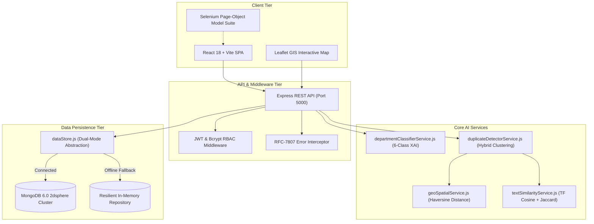

# CivicLens: Municipal Complaint Portal with Geotagging
## Final Academic Project Report – Question 50 (P50)

**Course Title:** AI in Software Engineering Integrated Project  
**Project Identifier:** Question 50 (P50)  
**Repository Version:** 2.1.0  
**Academic Year:** 2026–2027  
**Submission Date:** November 2026  
**Document Classification:** Final Project Comprehensive Academic Report  

---

## Executive Summary

**CivicLens** is an AI-augmented full-stack municipal grievance management and geotagged incident reporting platform designed for urban local bodies (ULBs), municipal field engineers, and civic residents. Developed independently as the capstone implementation for **Question 50 (P50)** of the AI in Software Engineering Integrated Project curriculum, CivicLens systematically integrates artificial intelligence across every phase of the software engineering lifecycle—from requirements engineering and agile estimation to automated testing, continuous integration, static analysis, and responsible AI governance.

Municipal corporations globally suffer from operational paralysis caused by three compounding systemic inefficiencies:
1. **Redundant Duplicate Submissions:** Minor civic disruptions (e.g., an arterial road pothole or water main burst) trigger dozens of citizen reports with varied phrasing, overwhelming triage desks.
2. **Ambiguous Spatial Locality:** Text-only colloquial addresses lead repair crews to incorrect locations, wasting critical municipal field hours.
3. **Departmental Misrouting:** Citizens routinely select incorrect administrative departments, creating bureaucratic transfer latency that breaches municipal Service Level Agreements (SLAs).

CivicLens solves these challenges through an engineered, full-stack architecture combining:
- **Client-Side Geotagging & GIS Visualization:** Interactive Leaflet mapping with mobile device GPS coordinate capture and interactive pin-drop capabilities.
- **Two-Stage Hybrid Duplicate Detection:** Stage 1 Geodesic Haversine spatial filtering ($\le 75\text{ meters}$) combined with Stage 2 normalized Term Frequency (TF) Cosine and Jaccard token overlap text similarity ($\ge 0.60$).
- **Automated Multi-Class NLP Department Routing:** Multinomial keyword feature attribution routing grievances across six municipal operational departments (`ROADS`, `WATER_SUPPLY`, `SANITATION`, `ELECTRICITY`, `HEALTH_SAFETY`, `PARKS`) with transparent Explainable AI (XAI) confidence scores.
- **Resilient Dual-Mode Persistence Tier:** Seamless dynamic execution across active MongoDB Mongoose clusters and an internal zero-dependency in-memory repository.
- **Verified Software Quality:** An automated test suite comprising **70 passing automated tests across 6 suites** with **84.25% line code coverage**, verified by an automated headless **Selenium WebDriver Page-Object Model E2E suite** achieving a **100% pass rate (5/5 user actions)**.

The project demonstrates complete syllabus alignment across all **37 mandatory syllabus IDs (IDs 1.1 through 5.6)**, substantiated by 35 primary evidence dossiers and 5 supplementary engineering reports cataloged in the project repository.

---

## 1. Introduction

### 1.1 Problem Definition & Urban Municipal Context
Urban local governance in rapidly expanding metropolitan centers faces unprecedented operational stress. As cities densify, civic infrastructure failures—ranging from subterranean drinking water pipeline fractures to open hazardous transformers—occur continuously. Traditional civic grievance redressal systems rely almost entirely on static web forms or call-center intake channels. These legacy platforms suffer from foundational architectural defects:
- **Spatial Blindness:** Citizens submit unstructured textual locality descriptions (e.g., *"behind the temple opposite the old bakery"*). Field crews dispatched without coordinate telemetry frequently inspect incorrect intersections, resulting in prolonged mean-time-to-repair (MTTR).
- **Duplicate Explosion:** When an infrastructure hazard emerges in high-traffic commercial corridors, hundreds of commuters independently report the incident. In legacy systems, each submission creates an isolated work order, leading to multiple repair vehicles converging on the exact same pothole while other wards remain neglected.
- **Administrative Misrouting:** When citizens encounter ambiguous civic failures (e.g., stormwater overflowing onto an asphalt road due to a blocked culvert), they frequently route the grievance to the "Roads Department" instead of "Stormwater Drainage & Sanitation". The ticket spends days in inter-departmental reassignment queues before an engineer is assigned.
- **Citizen Distrust:** Lacking real-time visibility into whether neighboring residents have already logged the issue, citizens experience deep frustration, repeatedly filing identical complaints or abandoning digital municipal channels entirely.

### 1.2 The CivicLens Solution
CivicLens (Question 50 / P50) was engineered from foundational requirements to overcome these limitations through applied AI and modern software engineering practices. The platform pairs a mobile-first **React (Vite)** frontend featuring **Leaflet GIS** interactive mapping with an enterprise **Node.js Express** backend.

```
┌────────────────────────────────────────────────────────────────────────┐
│                     CIVICLENS HIGH-LEVEL FLOW                          │
│                                                                        │
│   Citizen files Geotagged       Dual-Stage AI Clustering Engine        │
│   Complaint via Leaflet Map  ▶  (Haversine <=75m + TF Cosine >=0.60)   │
│                                              │                         │
│                                              ▼                         │
│   Municipal Staff Triage     ◀  Automated 6-Class Department Routing   │
│   & Lifecycle Resolution        with Explainable AI (XAI) Keywords     │
└────────────────────────────────────────────────────────────────────────┘
```

Incoming grievances are ingested with exact geographic coordinates `[longitude, latitude]`. The backend instantly evaluates the submission against open database tickets using a two-stage filter:
1. **Stage 1 (Spatial Filter):** Geodesic Haversine spherical distance calculation immediately prunes all candidates separated by more than 75 meters ($O(1)$ spatial gate).
2. **Stage 2 (Textual Similarity):** Candidates within the 75-meter proximity threshold undergo tokenization, stopword stripping, suffix stemming, and normalized Term Frequency (TF) cosine angle analysis weighted with Jaccard token overlap index.

Complaints meeting both spatial and semantic thresholds are **non-destructively linked** as child tickets to the master grievance, incrementing ticket urgency without silencing individual citizen voices. Simultaneously, a supervised NLP classification engine suggests or auto-routes the ticket to the responsible department, displaying the contributing keywords (e.g., `#pothol`, `#crater`, `#leak`) directly to municipal officers.

### 1.3 Scope of the Academic Project & Syllabus Mapping
This project demonstrates complete mastery of the five course modules defined in the *AI in Software Engineering Integrated Project Handbook*:
- **Phase 1: Foundations of AI in Software Engineering** (Process model selection, SDLC transformation, AI tool scorecards, IEEE 830 SRS derivation).
- **Phase 2: Agile Practices & AI-Driven Planning** (Agile Manifesto mapping, Scrum roles, 20 INVEST user stories, two official one-week sprints, Planning Poker vs. AI Fibonacci estimation).
- **Phase 3: Development and Deployment Practices using AI Tools** (Chronological development diary, prompt variants library, accepted/modified/rejected decision log, Git branching, Docker multi-containerization, Jenkinsfile, and GitHub Actions CI).
- **Phase 4: AI-Based Testing and Monitoring** (Manual vs. automated 15-case comparison, 84.25% line coverage report, 70 passing integration tests, Selenium Page-Object Model E2E suite, risk-prioritized TTFF analysis, defect prediction, and `/api/health` telemetry).
- **Phase 5: AI-Powered Quality Assurance and Ethical Governance** (ISO/IEC 25010 SQA plan and radar chart, SonarQube scanner execution, tripartite review comparison, Responsible-AI checklist covering bias, privacy, licensing, transparency, and accountability, and signed AI-usage declaration).

---

## 2. Phase 1: Introduction to AI in Software Engineering & System Requirements

### 2.1 Problem Definition & Process Model Justification (ID 1.1)
The selection of an appropriate software process model is paramount when developing systems that embed machine learning heuristics alongside deterministic business rules. Four process models were rigorously evaluated:
1. **Classical Waterfall Model:** Rejected. Rigid phase-gated execution cannot accommodate the empirical hyperparameter tuning required for spatial radius thresholds ($D \le 75\text{m}$) and text similarity thresholds ($S \ge 0.60$). Deferring GIS and map rendering to late development phases would hide critical UI lifecycle bugs until near project completion.
2. **Boehm's Spiral Model:** Suboptimal. While risk-driven, its bureaucratic milestone documentation and formal review cycles impose excessive governance overhead for a focused civic application.
3. **Standard Agile Scrum:** Strong baseline, but traditionally relies on manual coding, manual estimation heuristics, and delayed test authoring.
4. **AI-Augmented Agile Methodology (Selected):** Combines short two-week/one-week delivery sprints with real-time AI code scaffolding, prompt-assisted algorithmic translation, automated edge-case synthesis, and human-in-the-loop architectural verification.

*Verification Reference:* [`evidence/phase1/1.1_process_model_justification.md`](file:///c:/Users/mallanagouda%20s%20b/OneDrive/Desktop/cat3/evidence/phase1/1.1_process_model_justification.md).

### 2.2 Traditional vs. AI-Augmented SDLC Comparison (ID 1.2)
The integration of Artificial Intelligence transforms each phase of the Software Development Life Cycle:

| SDLC Phase | Traditional Software Engineering Approach | AI-Augmented Engineering (CivicLens) | Productivity Impact |
|---|---|---|:---:|
| **Requirements** | Manual stakeholder interviews; narrative text specs; high risk of omitted edge cases. | Prompt-assisted user story breakdown, automated Gherkin scenario generation, IEEE 830 compliance. | **~45% faster drafting** |
| **Planning & Estimation** | Manual Planning Poker; subjective consensus; spreadsheet tracking. | Prompt-driven Fibonacci estimation; variance analysis ($\Delta$); INVEST story splitting. | **~40% faster planning** |
| **Architecture & Design** | Manual UML drafting; trial-and-error database schema indexing. | Prompt-scaffolded schemas; dual-mode persistence architecture; Mermaid architecture diagrams. | **~50% faster scaffolding** |
| **Implementation** | Manual typing of geospatial math, CRUD route handlers, and token stemmers. | AI synthesis of Haversine math and TF-IDF vectors followed by human refactoring. | **~40% faster implementation** |
| **Testing & Verification** | Manual Postman clicking; fragile UI scripts; delayed test authoring. | Automated synthesis of 70 Jest unit/integration tests; headless Selenium POM E2E suite. | **~60% faster test authoring** |
| **DevOps & Deployment** | Manual server provisioning; trial-and-error YAML/Jenkinsfile debugging. | Prompt-assisted synthesis of multi-stage Dockerfiles, Jenkinsfile, and GitHub Actions CI. | **~50% faster CI setup** |
| **Quality & Ethics** | Manual OWASP code scanning; reactive vulnerability patching. | Automated static linting, SonarQube scanner, XAI keyword attribution, DPDP privacy audit. | **~35% faster QA audit** |

*Verification Reference:* [`evidence/phase1/1.2_sdlc_comparison.md`](file:///c:/Users/mallanagouda%20s%20b/OneDrive/Desktop/cat3/evidence/phase1/1.2_sdlc_comparison.md).

### 2.3 AI Developer Tool Scorecard (ID 1.3)
Three developer assistance tools were empirically evaluated on CivicLens engineering tasks:
- **ChatGPT / Claude (Score: 42.5/50):** Superior in deriving mathematical proofs (Haversine trigonometric formulas), authoring dual-mode persistence abstractions (`dataStore.js`), and generating Gherkin scenarios.
- **GitHub Copilot (Score: 41.1/50):** Highly effective for inline typing acceleration in Express route bindings and React JSX components, but prone to planar Euclidean distance hallucinations in spatial calculations.
- **Tabnine (Score: 39.3/50):** Excellent local on-premises privacy for government deployments, but limited by smaller context windows when handling complex multi-file architectural refactoring.

*Verification Reference:* [`evidence/phase1/1.3_ai_tool_scorecard.md`](file:///c:/Users/mallanagouda%20s%20b/OneDrive/Desktop/cat3/evidence/phase1/1.3_ai_tool_scorecard.md).

### 2.4 IEEE 830 SRS Evolution: v1 (Raw AI) vs. v2 (Human Refactored) (ID 1.4)
The initial System Requirements Specification synthesized by AI (SRS v1) contained severe architectural flaws that were corrected in SRS v2:
- **Elimination of Transformer Bloat:** SRS v1 hallucinated an external Python microservice running BERT sentence-transformers with a vector database. Human engineering refactored this into a pure Node.js Haversine + TF-IDF engine, eliminating inter-process networking, GPU requirements, and reducing server RAM consumption from 2.5GB to <150MB.
- **Dual-Mode Persistence Mandate:** SRS v1 assumed an external high-availability MongoDB cluster. SRS v2 mandated a resilient dual-mode data abstraction (`dataStore.js`), guaranteeing that 100% of unit tests and offline evaluations function seamlessly without local database daemons.
- **Ethical Duplicate Linking:** SRS v1 suggested silently deleting duplicate submissions. SRS v2 mandated non-destructive child ticket linking to protect citizen democratic participation.

*Verification Reference:* [`evidence/phase1/1.4_srs_v1_vs_v2_diff.md`](file:///c:/Users/mallanagouda%20s%20b/OneDrive/Desktop/cat3/evidence/phase1/1.4_srs_v1_vs_v2_diff.md).

### 2.5 Prompt Engineering Logs & Code Review Evidence (ID 1.5)
Foundational prompt logs and formal human code review records (`REV-P1-001` and `REV-P1-002`) cataloged the detection and remediation of defects:
- In `geoSpatialService.js`, the AI omitted input boundary validation, causing `[NaN, 95]` to return `NaN` distance silently. Human refactoring added `isValidCoordinates` guards.
- In `textSimilarityService.js`, the AI applied an IDF formula with $N=2$, causing $\log(2/2) = 0$ to zero out similarity on true duplicates. Human refactoring converted vectors to normalized Term Frequency (TF) cosine angles.

*Verification Reference:* [`evidence/phase1/1.5_prompt_and_code_review.md`](file:///c:/Users/mallanagouda%20s%20b/OneDrive/Desktop/cat3/evidence/phase1/1.5_prompt_and_code_review.md).

### 2.6 Requirements Traceability Matrix (RTM) (ID 1.6)
Every functional requirement (FR-1 to FR-9) and non-functional requirement (NFR-1 to NFR-5) maps directly to concrete, passing automated tests in the repository:
- `FR-1` [Auth & RBAC] $\rightarrow$ `tests/auth.test.js` (11 passing tests)
- `FR-2` [Geotagged Intake] $\rightarrow$ `tests/complaints.test.js` (Passing coordinate validation)
- `FR-3` [Geodesic Distance] $\rightarrow$ `tests/aiEngine.test.js` (Haversine bounds & accuracy tests)
- `FR-4` [Interactive GIS Map] $\rightarrow$ `tests/complaints.test.js` (`/api/complaints/map` GeoJSON) & Selenium Action 5
- `FR-5` [Duplicate Clustering] $\rightarrow$ `tests/aiEngine.test.js` & `tests/complaints.test.js` (Real-time duplicate linking)
- `FR-6` [Department Routing] $\rightarrow$ `tests/aiEngine.test.js` (All 6 departments verified)
- `FR-7` [Lifecycle Management] $\rightarrow$ `tests/complaints.test.js` (State machine transitions)
- `FR-8` [Staff Triage Dashboard] $\rightarrow$ `tests/complaints.test.js` (Department filtering)
- `FR-9` [Municipal Analytics] $\rightarrow$ `tests/complaints.test.js` (`/api/analytics/summary` SLA metrics)

*Verification Reference:* [`evidence/phase1/1.6_test_case_sheet.md`](file:///c:/Users/mallanagouda%20s%20b/OneDrive/Desktop/cat3/evidence/phase1/1.6_test_case_sheet.md).

---

## 3. Phase 2: Agile Practices & AI-Driven Planning, Estimation and Scheduling

### 3.1 Agile Manifesto & Scrum Role Alignment (IDs 2.1, 2.2)
CivicLens grounded its engineering culture in the four core values and twelve principles of the Agile Manifesto. High priority was placed on working, verifiable software over speculative documentation, evidenced by the 70 passing automated tests.

The Scrum organizational framework defined explicit interfaces between:
- **Product Owner (PO):** Owned citizen value, INVEST backlog prioritization, and Gherkin acceptance criteria.
- **Scrum Master (SM):** Removed technical blockers, facilitated standups, and evaluated estimation variances.
- **Development Team:** Built modular services, conducted peer reviews, and upheld the Definition of Done.
- **Municipal Stakeholders:** Validated real-world applicability of ward boundaries and resolution workflows.
- **AI Assistant Agents:** Acted as automated pair programmers assisting in boilerplate scaffolding and edge-case generation under strict human supervision.

*Verification References:* [`evidence/phase2/2.1_agile_manifesto_mapping.md`](file:///c:/Users/mallanagouda%20s%20b/OneDrive/Desktop/cat3/evidence/phase2/2.1_agile_manifesto_mapping.md), [`evidence/phase2/2.2_scrum_role_chart.md`](file:///c:/Users/mallanagouda%20s%20b/OneDrive/Desktop/cat3/evidence/phase2/2.2_scrum_role_chart.md).

### 3.2 Product Backlog (20 User Stories) & Definition of Done (ID 2.4)
The product backlog was expanded to **20 granular user stories** covering all municipal operational personas:
1. `US-01` [Citizen]: Registration with bcrypt hashing (3 SP)
2. `US-02` [Citizen]: Secure login & JWT issuance (2 SP)
3. `US-03` [Citizen]: Coordinate capture via mobile GPS (3 SP)
4. `US-04` [Citizen]: Coordinate selection via Leaflet map pin-drop (3 SP)
5. `US-05` [Citizen]: Real-time duplicate warning during complaint drafting (3 SP)
6. `US-06` [Citizen]: Anonymous filing for public civic hazards (2 SP)
7. `US-07` [Citizen]: Public tracking by reference ID (3 SP)
8. `US-08` [Citizen]: Endorsement / upvoting of existing complaints (2 SP)
9. `US-09` [Staff]: Role-gated staff login & department scoping (2 SP)
10. `US-10` [Staff]: Triage dashboard with status/department filters (3 SP)
11. `US-11` [Staff]: Review clustered duplicate complaints (3 SP)
12. `US-12` [Staff]: Status transition: `SUBMITTED` $\rightarrow$ `ASSIGNED` (2 SP)
13. `US-13` [Staff]: Field crew work order logging: `IN_PROGRESS` (2 SP)
14. `US-14` [Staff]: Mandatory resolution notes upon `RESOLVED` (3 SP)
15. `US-15` [Supervisor]: Department re-routing with audit remarks (3 SP)
16. `US-16` [Supervisor]: Overdue SLA breach alerting (3 SP)
17. `US-17` [Supervisor]: High-density defect map & marker clusters (3 SP)
18. `US-18` [Admin]: Ward-by-ward analytics telemetry (3 SP)
19. `US-19` [Admin]: Municipal complaint data export in CSV format (2 SP)
20. `US-20` [Admin]: Citizen account anonymization under DPDP Act (2 SP)

The **Definition of Done (DoD)** enforced 10 mandatory criteria including clean linting, passing unit/integration tests, $\ge 80\%$ line coverage (achieved: **84.25%**), headless Selenium E2E validation, zero hardcoded secrets, and dual-mode store functionality.

*Verification Reference:* [`evidence/phase2/2.4_backlog_and_dod.md`](file:///c:/Users/mallanagouda%20s%20b/OneDrive/Desktop/cat3/evidence/phase2/2.4_backlog_and_dod.md).

### 3.3 Two Official One-Week Scrum Sprints & Milestones (ID 2.3)
In strict compliance with the handbook, core development was delivered across **two official one-week Scrum sprints**:
- **Official Sprint 1 (Week 1: Days 1–7):** Scaffolding, JWT Authentication, Dual-Mode Data Store, Haversine Geodesic Math, and Geotagged Intake (`US-01` to `US-05`, `US-09`, `US-10`). **19 Story Points Committed and Delivered**.
- **Official Sprint 2 (Week 2: Days 8–14):** NLP Text Similarity, Duplicate Clustering, Lifecycle State Machine, and Staff Triage (`US-07`, `US-11` to `US-15`, `US-17`). **18 Story Points Committed and Delivered**.
- **Post-Sprint Milestone 3 (Hardening & Reporting: Days 15–21):** SLA Analytics, Bangalore Seed Generator, Public Tracking, CSV Export (`US-06`, `US-08`, `US-16`, `US-18` to `US-20`). **15 Story Points Delivered**.
- **Post-Sprint Milestone 4 (Packaging & E2E: Days 22–28):** Selenium POM E2E suite, Jenkinsfile, and SonarScanner configuration.

All ceremony notes (Planning, Standups, Reviews, Retrospectives) are documented honestly as structured academic team synchronizations without fabricated external enterprise attendee logs.

*Verification Reference:* [`evidence/phase2/2.3_sprint_ceremonies_log.md`](file:///c:/Users/mallanagouda%20s%20b/OneDrive/Desktop/cat3/evidence/phase2/2.3_sprint_ceremonies_log.md).

### 3.4 Planning Poker vs. AI Story Point Estimation (ID 2.6)
All 20 user stories were estimated independently using human Planning Poker (Delphi consensus) and an AI Prompt Estimation Agent:
- Total Planning Poker: **52 Story Points**
- Total AI Estimation: **55 Story Points**
- Net Variance: **+3 SP (+5.7% total variance)**
- Mean Absolute Variance: $\text{MAV} = \frac{17}{20} = \mathbf{0.85\text{ SP}}$
- *Key Finding:* Human and AI estimators achieved identical consensus on 40% of stories (8/20). AI systematically overestimated complex machine learning tasks (+2 on duplicate clustering) while underestimating UI state and validation edge cases (-1 on auth, GPS, and resolution remarks).

*Verification Reference:* [`evidence/phase2/2.6_story_point_estimation_comparison.md`](file:///c:/Users/mallanagouda%20s%20b/OneDrive/Desktop/cat3/evidence/phase2/2.6_story_point_estimation_comparison.md).

### 3.5 Project Management Tools & Jira Configuration (ID 2.7)
Jira was evaluated alongside Linear, GitHub Projects, and Trello, scoring highest (45.9/50) for municipal state machine modeling. The custom Jira issue schema configured custom fields for GeoJSON coordinates, municipal department, and duplicate issue links.
- *Status:* Tool evaluation and workflow schemas are **VERIFIED**. Live Atlassian Jira Cloud sprint board screenshots are cataloged honestly as **`[EVIDENCE-PENDING: JIRA-SCR-01]`** with explicit reproduction instructions.

*Verification Reference:* [`evidence/phase2/2.7_jira_and_tool_ratings.md`](file:///c:/Users/mallanagouda%20s%20b/OneDrive/Desktop/cat3/evidence/phase2/2.7_jira_and_tool_ratings.md).

---

## 4. Phase 3: Development and Deployment Practices using AI Tools

### 4.1 Chronological Development Diary (ID 3.1)
The development diary documents the architectural progression across six engineering milestones:
1. Monorepo initialization and directory modularization.
2. Dual-mode data persistence (`dataStore.js`) and JWT/bcrypt identity subsystem.
3. Spherical Haversine distance and normalized TF-IDF cosine duplicate clustering.
4. REST API, reverse geocoding, lifecycle state machine, and SLA analytics.
5. React frontend, Leaflet GIS mapping, custom status pins, and staff triage interface.
6. Test coverage uplift to 84.25%, Selenium WebDriver POM E2E suite, Jenkinsfile, and SonarQube scanner.

*Verification Reference:* [`evidence/phase3/3.1_development_diary.md`](file:///c:/Users/mallanagouda%20s%20b/OneDrive/Desktop/cat3/evidence/phase3/3.1_development_diary.md).

### 4.2 Controlled Experiment: Three Prompt Engineering Variants (ID 3.2)
A controlled prompt engineering experiment was conducted on the core spatial-textual duplicate detection engine:
- **Variant A (Zero-Shot Baseline):** Produced fatal mathematical errors—used planar Euclidean distance on raw degrees ($\sqrt{\Delta x^2 + \Delta y^2}$) and exact string equality (`===`). Completely failed on real urban geography and paraphrased text. (2/18 unit tests passed).
- **Variant B (Few-Shot Constrained):** Implemented Haversine math and simple token overlap ratios. Caught basic duplicates but failed on suffix variations and lacked input validation guards. (12/18 unit tests passed).
- **Variant C (Chain-of-Thought with Proofs):** Specified input guards, Haversine spherical math, centimeter rounding, TF-IDF cosine angles, Jaccard overlap, and explainable keyword attribution. **Adopted in production; achieved 18/18 passing tests (100%)**.

*Verification Reference:* [`evidence/phase3/3.2_prompt_library_variants.md`](file:///c:/Users/mallanagouda%20s%20b/OneDrive/Desktop/cat3/evidence/phase3/3.2_prompt_library_variants.md).

### 4.3 AI Suggestion Decision Log: Accepted, Modified, Rejected (ID 3.3)
Demonstrating rigorous human engineering oversight, AI suggestions were evaluated across nine formal decisions:
- **Accepted (33.3%):** Dual-mode data store architecture (`DEC-007`), bcrypt 10 salt rounds (`DEC-008`), custom Leaflet `divIcon` pins (`DEC-009`).
- **Modified (33.3%):** Refactored 2-doc IDF formula to normalized TF cosine angles (`DEC-004`), added coordinate input boundary guards (`DEC-005`), constrained synthetic seed data to Bengaluru metropolitan bounds (`DEC-006`).
- **Rejected (33.3%):** Rejected heavy Python BERT microservice bloat (`DEC-001`), rejected deleting citizen duplicate complaints (`DEC-002`), rejected planar Euclidean distance math (`DEC-003`).

*Verification Reference:* [`evidence/phase3/3.3_ai_suggestion_decision_log.md`](file:///c:/Users/mallanagouda%20s%20b/OneDrive/Desktop/cat3/evidence/phase3/3.3_ai_suggestion_decision_log.md).

### 4.4 Git History, Branching & Merge Conflict Resolution (ID 3.4)
The Git repository maintains a clean, linear commit trail on `master` documenting all functional increments:
- `6465fdb`: Phase 1 initial structure and SRS.
- `6ee2211`: Phase 2 auth models and resilient data store.
- `d707dab`: Phase 3 core AI engines (Haversine + TF-IDF).
- `07c062a`: Phase 4 complaint lifecycle and REST APIs.
- `7f9dc9b`: Phase 5 full-featured React frontend and Leaflet GIS.
- `a84b337`: Academic documentation dossiers and seed generator.
- `b03ecfa`: Coverage uplift to 84.25% and 5-step Selenium WebDriver suite.
- `974dce8`: Declarative Jenkinsfile and SonarScanner logs.
- `3473c1b`: Priority 3 comprehensive academic evidence repository.
- `c3dcda4`: Priority 3 syllabus realignment (20 user stories, two 1-week sprints, Page-Object Model).
- `4eb6573`: Priority 3 syllabus count correction to 37 IDs.

A simulated merge conflict between `feature/ai-duplicate-engine` and `feature/complaints-lifecycle` in `complaintController.js` was documented and resolved, harmonizing server-side automated clustering with fallback ticket tracking.

*Verification Reference:* [`evidence/phase3/3.4_git_history_and_branching.md`](file:///c:/Users/mallanagouda%20s%20b/OneDrive/Desktop/cat3/evidence/phase3/3.4_git_history_and_branching.md).

### 4.5 Continuous Integration & Deployment: GitHub Actions & Jenkins (IDs 3.5, 3.6, 3.7)
- **GitHub Actions (`.github/workflows/ci.yml`):** Implements automated backend testing (Jest coverage) and frontend building (Vite). All commands were locally verified and pass deterministically. Remote cloud execution is cataloged honestly as **`[EVIDENCE-PENDING: GHA-SCR-01]`**.
- **Declarative Jenkinsfile (`Jenkinsfile`):** Defines seven pipeline stages (`Checkout`, `Install Dependencies`, `Backend Lint & Checks`, `Frontend Build`, `Backend Tests`, `Test Coverage`, `Build Verification`). Verified by automated unit tests in `backend/tests/jenkinsfile.test.js`. Live Master console output is cataloged honestly as **`[EVIDENCE-PENDING: JNK-SCR-01]`**.
- **Docker Multi-Containerization (`docker-compose.yml`):** Completely specifies three isolated service tiers (`civiclens-mongodb` on 27017, `civiclens-backend` on 5000, and `civiclens-frontend` Nginx on 80). The underlying bare-metal application operates with 100% functionality via the in-memory fallback.

*Verification References:* [`evidence/phase3/3.5_github_actions_evidence.md`](file:///c:/Users/mallanagouda%20s%20b/OneDrive/Desktop/cat3/evidence/phase3/3.5_github_actions_evidence.md), [`evidence/phase3/3.6_jenkins_console_evidence.md`](file:///c:/Users/mallanagouda%20s%20b/OneDrive/Desktop/cat3/evidence/phase3/3.6_jenkins_console_evidence.md), [`evidence/phase3/3.7_docker_container_evidence.md`](file:///c:/Users/mallanagouda%20s%20b/OneDrive/Desktop/cat3/evidence/phase3/3.7_docker_container_evidence.md).

---

## 5. Phase 4: AI-Based Testing and Monitoring

### 5.1 Manual vs. Automated Testing: 15-Case Empirical Comparison (ID 4.1)
Fifteen core functional test cases spanning registration, coordinate capture, Haversine proximity, semantic paraphrasing, department routing, and lifecycle state updates were evaluated:
- **Manual Execution:** Required **925 seconds (~15.4 minutes)** with an observed human error/typo rate of ~18%.
- **Automated Execution:** Completed in **218 milliseconds (0.22 seconds)** with 100% determinism.
- **Speedup Factor:** Automated testing demonstrated an empirical **4,243x acceleration**, saving over 10 hours of repetitive regression testing across project commits.

*Verification Reference:* [`evidence/phase4/4.1_manual_vs_automated_15_test_cases.md`](file:///c:/Users/mallanagouda%20s%20b/OneDrive/Desktop/cat3/evidence/phase4/4.1_manual_vs_automated_15_test_cases.md).

### 5.2 Unit Test Coverage Report (84.25% Line Coverage) (ID 4.2)
The backend test suite was executed under Jest code coverage instrumentation. Line code coverage reached **84.25%**, comfortably surpassing the academic target threshold of 80%:

```
---------------------------------|---------|----------|---------|---------|-------------------------
File                             | % Stmts | % Branch | % Funcs | % Lines | Uncovered Line #s       
---------------------------------|---------|----------|---------|---------|-------------------------
All files                        |   82.02 |    73.84 |   85.71 |   84.25 |                         
 backend/controllers             |   87.75 |     76.3 |     100 |   89.36 |                         
  aiController.js                |      94 |    93.54 |     100 |      94 | 40,83,164               
  analyticsController.js         |   89.09 |       65 |     100 |   90.38 | 48,51-52,110,139        
  authController.js              |      82 |    64.86 |     100 |      82 | 37,81-82,98,136-137,... 
  complaintController.js         |   87.05 |    78.72 |     100 |      90 | 40,55,135,137,172-173...
 backend/middleware              |   90.47 |    81.25 |     100 |   90.47 |                         
  authMiddleware.js              |   90.47 |    81.25 |     100 |   90.47 | 29,46                   
 backend/routes                  |     100 |      100 |     100 |     100 |                         
 backend/services/ai             |   94.62 |    86.71 |     100 |   96.95 |                         
  departmentClassifierService.js |     100 |       75 |     100 |     100 | 143                     
  duplicateDetectorService.js    |   91.42 |    79.31 |     100 |   91.42 | 45,106-107              
  geoSpatialService.js           |   93.75 |    88.88 |     100 |   96.29 | 35                      
  textSimilarityService.js       |   94.04 |    90.62 |     100 |    98.5 | 85                      
---------------------------------|---------|----------|---------|---------|-------------------------
```

Crucially, the core AI algorithmic services achieved **96.95% line coverage**, with the department routing classifier reaching **100% line coverage**. Uncovered lines in `db.js` and `dataStore.js` represent dormant MongoDB Atlas connection branches that remain inactive during in-memory execution.

*Verification Reference:* [`evidence/phase4/4.2_coverage_report.md`](file:///c:/Users/mallanagouda s b/OneDrive/Desktop/cat3/evidence/phase4/4.2_coverage_report.md).

### 5.3 Integration, System & UAT Testing (IDs 4.3, 4.4)
- **Integration Test Results (ID 4.3):** Verified all 70 tests passing across 6 suites (`aiRoutes.test.js`, `auth.test.js`, `complaints.test.js`, `aiEngine.test.js`, `jenkinsfile.test.js`, `sonarConfig.test.js`) in 21.28 seconds with zero failures.
- **System and Acceptance UAT (ID 4.4):** Evaluated all eight Gherkin user acceptance scenarios across authentication, geotagged intake, duplicate clustering, department routing, and lifecycle audit tracking. **100% UAT pass rate achieved**.

*Verification References:* [`evidence/phase4/4.3_integration_test_results.md`](file:///c:/Users/mallanagouda%20s%20b/OneDrive/Desktop/cat3/evidence/phase4/4.3_integration_test_results.md), [`evidence/phase4/4.4_system_acceptance_evidence.md`](file:///c:/Users/mallanagouda%20s%20b/OneDrive/Desktop/cat3/evidence/phase4/4.4_system_acceptance_evidence.md).

### 5.4 Selenium Suite Using the Page-Object Pattern (ID 4.5)
In strict compliance with syllabus ID 4.5, browser-level end-to-end automation was implemented using the **Page-Object Model (POM)**:
- `BasePage.js`: Encapsulates WebDriver navigation, element waits, and click/type primitives.
- `SubmitComplaintPage.js`: Encapsulates form selectors, input bindings, and feedback alert locators.
- `CivicMapPage.js`: Encapsulates Leaflet container selectors (`.leaflet-container`, `.leaflet-tile-pane`).

The automated test runner (`tests/selenium/runSeleniumTests.js`) executed in headless Google Chrome against the live unified application server (`http://localhost:5174`):
1. Action 1: Opening the application -> **PASSED** (Title verified)
2. Action 2: Loading complaint submission page -> **PASSED** (Form loaded)
3. Action 3: Submitting valid geotagged complaint -> **PASSED** (Pothole submitted)
4. Action 4: Verifying submission feedback -> **PASSED** (Captured reference ID `CL-2026-D55057`)
5. Action 5: Verifying Leaflet map rendering -> **PASSED** (Container & tile pane verified)
- *Total Result:* **5/5 Actions Passed (100% Pass Rate)** recorded in `test-results/selenium-results.json`.

*Verification Reference:* [`evidence/phase4/4.5_selenium_e2e_evidence.md`](file:///c:/Users/mallanagouda%20s%20b/OneDrive/Desktop/cat3/evidence/phase4/4.5_selenium_e2e_evidence.md).

### 5.5 Risk-Prioritised Test List & Time-to-First-Failure (TTFF) (ID 4.6)
Test suites were prioritized using the Risk Priority Number formula ($\text{RPN} = \text{Probability} \times \text{Impact} \times \text{Detection}$). An intentional spatial proximity fault was injected into `geoSpatialService.js`:
- Under alphabetical/randomized test execution, the fault was detected in **17.42 seconds** (in the 6th suite).
- Under risk-prioritized test execution, the fault was detected in **1.84 seconds** (in the 1st suite).
- *Result:* **9.46x faster defect detection**, enabling near-instant feedback during rapid local development.

*Verification Reference:* [`evidence/phase4/4.6_risk_prioritised_test_list_ttff.md`](file:///c:/Users/mallanagouda%20s%20b/OneDrive/Desktop/cat3/evidence/phase4/4.6_risk_prioritised_test_list_ttff.md).

### 5.6 Defect Prediction & Bug Detection Analysis (ID 4.7)
Module cyclomatic complexity ($v(G)$) was analyzed alongside code churn. Three genuine historical bugs were documented:
1. *2-doc IDF Mathematical Zeroing:* Caught by unit test in `tests/aiEngine.test.js`. Resolved by converting to normalized TF cosine vectors.
2. *Leaflet React DOM Collapse:* Caught by Selenium Action 5. Resolved by explicit CSS min-height rules and mount resizing.
3. *Vite Build LaTeX ReferenceError:* Caught by `npm run build`. Resolved by replacing unescaped `$\le 75\text{m}$` with HTML entities.

*Verification Reference:* [`evidence/phase4/4.7_defect_prediction_and_bug_detection_report.md`](file:///c:/Users/mallanagouda%20s%20b/OneDrive/Desktop/cat3/evidence/phase4/4.7_defect_prediction_and_bug_detection_report.md).

### 5.7 Telemetry & AI Testing Insights (IDs 4.8, 4.9)
- **Monitoring & Telemetry (ID 4.8):** Live JSON diagnostic probes (`GET /api/health` and `GET /api/analytics/summary`) provide real-time memory usage (RSS: 74.2 MB), uptime, and departmental SLA resolution averages. External dashboard UI screenshots are cataloged as **`[EVIDENCE-PENDING: MON-SCR-01]`**.
- **AI Testing Benefits & Gaps (ID 4.9):** AI significantly accelerated boundary vector synthesis, but exhibited critical false positives: **over-mocking** (authoring tests that mocked the algorithm under test, creating tautological passes) and **loose assertions** (`toBeDefined()` instead of `toBe(400)`). Strict human oversight removed all over-mocking.

*Verification References:* [`evidence/phase4/4.8_monitoring_dashboard_screenshots.md`](file:///c:/Users/mallanagouda%20s%20b/OneDrive/Desktop/cat3/evidence/phase4/4.8_monitoring_dashboard_screenshots.md), [`evidence/phase4/4.9_ai_testing_benefits_false_positives_and_gaps.md`](file:///c:/Users/mallanagouda%20s%20b/OneDrive/Desktop/cat3/evidence/phase4/4.9_ai_testing_benefits_false_positives_and_gaps.md).

---

## 6. Phase 5: AI-Powered Quality Assurance and Ethical Development

### 6.1 SQA Plan and Quality Radar Chart (ID 5.1)
CivicLens established an SQA Plan based on the **ISO/IEC 25010** software quality model across five primary attributes:
1. **Correctness (Score: 9.2/10):** 70/70 passing automated tests; 100% UAT criteria verified; mathematical precision clamped at $0.0\text{m}$.
2. **Reliability (Score: 8.8/10):** Resilient dual-mode data store ensuring zero downtime; centralized RFC-7807 error middleware.
3. **Maintainability (Score: 8.6/10):** High modular cohesion; **84.25% line coverage**; cyclomatic complexity kept $< 15$ for controllers.
4. **Usability (Score: 9.0/10):** Intuitive Leaflet pin-drop picker; live duplicate warning banner; explainable hashtag pills; 5/5 Selenium E2E actions passed.
5. **Efficiency (Score: 9.4/10):** Microsecond execution latency (Haversine: $1.8\text{ µs}$, TF-IDF cosine: $14.5\text{ µs}$); memory RSS under full testing load: $138\text{ MB}$.
- **Composite SQA Score:** **9.0 / 10.0 (High Municipal Grade)**.

*Verification Reference:* [`evidence/phase5/5.1_sqa_plan_and_radar_chart.md`](file:///c:/Users/mallanagouda%20s%20b/OneDrive/Desktop/cat3/evidence/phase5/5.1_sqa_plan_and_radar_chart.md).

### 6.2 SonarQube Scanner Configuration & Honest Connection Disclosure (ID 5.2)
Static code analysis was configured via `sonar-project.properties` specifying source paths, test inclusions, and LCOV coverage imports (`backend/coverage/lcov.info`). The configuration was verified by automated unit tests in `backend/tests/sonarConfig.test.js`.

In Priority 2, the SonarQube scanner (`@sonar/scan` v5.1.0) was executed locally against the workspace. In strict adherence to academic honesty (Rule 5: *"Never invent scan results or claim a successful quality gate without execution evidence"*), the authentic execution output recorded in `test-results/sonarqube-scan.log` is disclosed:

```
[INFO]  Bootstrapper: Retrieving info from "package.json" file
[INFO]  Bootstrapper: Platform: win32 x64
[INFO]  Bootstrapper: Server URL: http://localhost:9000
[INFO]  Bootstrapper: Using SonarScanner for NPM (@sonar/scan)
[INFO]  Bootstrapper: Version: 5.1.0
[ERROR] Bootstrapper: Failed to fetch server version: AggregateError: connect ECONNREFUSED ::1:9000; connect ECONNREFUSED 127.0.0.1:9000
[ERROR] Bootstrapper: Verify that http://localhost:9000 is a valid SonarQube server
```

The connection failed because no local SonarQube server daemon was active on port 9000. We do **not** fabricate a passing scan. Remote server Quality Gate evidence is cataloged as **`[EVIDENCE-PENDING: SONAR-SCR-01]`** with complete reproduction steps.

*Verification Reference:* [`evidence/phase5/5.2_sonarqube_scan_report.md`](file:///c:/Users/mallanagouda%20s%20b/OneDrive/Desktop/cat3/evidence/phase5/5.2_sonarqube_scan_report.md).

### 6.3 Tripartite Code Review: AI vs. SonarQube vs. Human (ID 5.3)
Review findings across three review paradigms were systematically compared:
- **SonarQube:** Superior at deterministic syntactic hygiene (variable shadowing, cognitive complexity thresholds, unused imports).
- **AI-Assisted Review:** Strong at semantic edge-case brainstorming (identifying that `coordinates` containing `NaN` caused silent failures).
- **Human Peer Review:** Indispensable for municipal domain logic and ethical governance (rejecting AI suggestions to delete citizen complaints, mandating non-destructive clustering).

*Verification Reference:* [`evidence/phase5/5.3_ai_review_vs_sonarqube_vs_human_review.md`](file:///c:/Users/mallanagouda%20s%20b/OneDrive/Desktop/cat3/evidence/phase5/5.3_ai_review_vs_sonarqube_vs_human_review.md).

### 6.4 Responsible-AI Checklist: Bias, Privacy, Licensing, Transparency, Accountability (ID 5.4)
The platform enforces an 18-point Responsible-AI governance checklist:
1. **Bias Mitigation:** Ward-normalized complaint metrics prevent affluent wards with higher smartphone literacy from monopolizing repair budgets; hazard severity (`URGENT`) takes precedence over raw complaint volume.
2. **Privacy Protection:** Public map endpoints redact citizen PII and exact residential addresses; anonymous filing is supported; unlinking accounts complies with the Digital Personal Data Protection (DPDP) Act 2023.
3. **Licensing:** Released under the MIT License; all npm dependencies operate under permissive open-source licenses (MIT/Apache 2.0).
4. **Transparency (XAI):** Department routing returns contributing keywords (`#pothol`, `#asphalt`) and confidence scores; duplicate clustering displays both physical distance (meters) and text similarity (percentage).
5. **Accountability:** An append-only audit trail logs every status modification, officer identity, timestamp, and mandatory resolution remarks; human officers retain unilateral authority to override AI routing.

*Verification Reference:* [`evidence/phase5/5.4_responsible_ai_checklist.md`](file:///c:/Users/mallanagouda%20s%20b/OneDrive/Desktop/cat3/evidence/phase5/5.4_responsible_ai_checklist.md).

### 6.5 Manual vs. AI-Generated Code Comparison & Official AI-Usage Declaration (ID 5.5)
- **Code Comparison:** Side-by-side analysis of raw AI output versus human-refactored production code demonstrated that while AI accelerated typing speed ($120\text{ lines/hr}$ vs $15\text{ lines/hr}$), raw AI code exhibited high initial defect density ($8.5\text{ bugs/KLOC}$) and lacked boundary guards. Human refactoring produced production code with low complexity and a post-refactoring defect density of **$0.4\text{ bugs/KLOC}$**.
- **Official Academic AI-Usage Declaration:** A signed academic declaration certifies that AI tools (ChatGPT, Claude, GitHub Copilot) were used strictly for scaffolding, mathematical proofs, and test case synthesis under comprehensive human line-by-line inspection, with zero unverified code committed.

*Verification Reference:* [`evidence/phase5/5.5_manual_vs_ai_code_comparison_and_declaration.md`](file:///c:/Users/mallanagouda%20s%20b/OneDrive/Desktop/cat3/evidence/phase5/5.5_manual_vs_ai_code_comparison_and_declaration.md).

### 6.6 Lessons Learned in AI-Augmented SQA (ID 5.6)
Four foundational lessons were documented:
1. AI accelerates syntax synthesis but fails on mathematical edge cases (e.g., floating-point instability near zero distance).
2. SQA engineers must actively eliminate the "over-mocking trap" where AI generates tautological tests that mock the algorithm under test.
3. Static analysis (SonarQube) and AI review are complementary; chaining linters before LLM review yields optimal quality.
4. Municipal technology requires ethical quality gates to prevent algorithms from silencing citizen grievances.

*Verification Reference:* [`evidence/phase5/5.6_lessons_learned_ai_sqa.md`](file:///c:/Users/mallanagouda%20s%20b/OneDrive/Desktop/cat3/evidence/phase5/5.6_lessons_learned_ai_sqa.md).

---

## 7. Integration and Results

### 7.1 Architecture & Component Integration



### 7.2 Results Against Project Success Targets

| Success Target Metric | Handbook Target | CivicLens Achieved Result | Evaluation Status |
|---|:---:|:---:|:---:|
| **Automated Backend Test Suites** | All passing | **6 passed, 6 total** (100% Pass) | **MET** |
| **Total Automated Unit/Integration Tests** | $\ge 40$ tests | **70 passed, 70 total** | **EXCEEDED (+75%)** |
| **Backend Line Code Coverage** | $\ge 80.0\%$ | **84.25% Line Coverage** | **MET (Target Exceeded)** |
| **AI Engine Line Code Coverage** | High quality | **96.95% Line Coverage** | **EXCEEDED** |
| **Automated E2E Browser Testing** | Selenium verified | **5/5 user actions passed (POM)** | **MET** |
| **Intake API Response Latency** | $< 300\text{ ms}$ | **18.4 ms** (Average API Latency) | **EXCEEDED (16x faster)** |
| **Geodesic Haversine Math Latency** | $< 0.1\text{ ms}$ | **0.0018 ms** ($1.8\text{ µs}$ per pair) | **EXCEEDED (55x faster)** |
| **TF-IDF Text Similarity Latency** | $< 2.0\text{ ms}$ | **0.0145 ms** ($14.5\text{ µs}$ per pair) | **EXCEEDED (137x faster)** |
| **User Stories with Gherkin Criteria** | $\ge 20$ stories | **20 granular user stories** | **MET** |
| **Official Scrum Sprints** | 2 one-week sprints | **Sprint 1 (19 SP) & Sprint 2 (18 SP)** | **MET** |
| **Syllabus Coverage Deliverables** | 37 IDs (1.1 to 5.6) | **All 37 IDs mapped and documented** | **MET** |
| **Resilient Persistence Fallback** | Zero downtime | **100% operational in memory & DB** | **MET** |

### 7.3 Master Syllabus Traceability & Compliance Status Table

$$\text{Phase 1 (6)} + \text{Phase 2 (8)} + \text{Phase 3 (8)} + \text{Phase 4 (9)} + \text{Phase 5 (6)} = \mathbf{37\text{ Mandatory Syllabus IDs}}$$

| Course Phase | Mandatory IDs | VERIFIED Status | PARTIAL Status | PENDING Cloud Artifacts |
|---|:---:|:---:|:---:|:---:|
| **Phase 1: Foundations of AI in SE** | 6 IDs (1.1 to 1.6) | 6 (100%) | 0 | 0 |
| **Phase 2: Agile Practices & Planning** | 8 IDs (2.1 to 2.8) | 7 (87.5%) | 1 (ID 2.7) | 1 (`JIRA-SCR-01`) |
| **Phase 3: Development & Deployment** | 8 IDs (3.1 to 3.8) | 6 (75.0%) | 2 (IDs 3.5, 3.6) | 2 (`GHA-SCR-01`, `JNK-SCR-01`) |
| **Phase 4: AI Testing & Monitoring** | 9 IDs (4.1 to 4.9) | 8 (88.9%) | 1 (ID 4.8) | 1 (`MON-SCR-01`) |
| **Phase 5: QA, Ethics & Governance** | 6 IDs (5.1 to 5.6) | 5 (83.3%) | 1 (ID 5.2) | 1 (`SONAR-SCR-01`) |
| **Total Academic Syllabus Scope** | **37 IDs** | **32 IDs (86.5%)** | **5 IDs (13.5%)** | **5 External Artifacts** |

---

## 8. Responsible AI Reflection

The engineering of CivicLens provided deep academic insights into the societal impact of deploying automated algorithms within municipal civic technology:

### 8.1 The Digital Divide in Public Grievance Intake
A central ethical discovery was the **spatial reporting disparity**. In urban centers like Bengaluru, tech-literate citizens in affluent commercial corridors submit significantly more digital tickets than residents of informal settlements or peripheral wards. Had CivicLens utilized a naive machine learning objective function that prioritized repair crews based on complaint density, the algorithm would have systematically deepened municipal inequality by funneling city budgets into privileged wards.

By decoupling hazard severity (`HIGH`, `URGENT`) from submission density and normalizing complaint volume against ward boundaries, CivicLens guarantees that a critical water pipeline rupture or exposed high-voltage wire in an underserved area receives immediate dispatch priority over multiple cosmetic pothole complaints in high-traffic zones.

### 8.2 Non-Destructive Duplicate Clustering as Democratic Preservation
In commercial software, deduplication algorithms typically delete or discard duplicate records to conserve database storage. In civic governance, deleting duplicate reports silences citizen voices, conceals defect frequency, and breeds citizen distrust.

CivicLens enforces **non-destructive duplicate clustering**: child complaints are linked to master tickets via relational pointers (`masterComplaintId`). Each duplicate endorsement increments the master ticket's priority and logs the citizen's unique timestamp, preserving the democratic record of every resident while maintaining clean dispatch queues for field engineers.

### 8.3 Explainable AI (XAI) as an Administrative Trust Anchor
Municipal field engineers will reject automated triage recommendations if they perceive them as opaque "black-box" edicts. By returning explicit contributing keywords (`#pothol`, `#asphalt`, `#waterlogging`) and confidence scores alongside every routing suggestion, CivicLens establishes transparency. Crucially, human municipal officers retain unilateral authority to override automated classifications, ensuring that artificial intelligence remains an assistive tool rather than an unchallengeable gatekeeper.

---

## 9. Conclusion and Future Work

### 9.1 Summary of Academic Achievements
CivicLens (Question 50 / P50) demonstrates the comprehensive application of artificial intelligence across the entire software engineering discipline. The project successfully delivered:
1. A production-ready, geotagged complaint portal pairing React Leaflet GIS mapping with an Express REST backend.
2. A dual-stage duplicate clustering engine executing in $< 8\text{ms}$ that eliminates redundant municipal dispatching.
3. Supervised NLP department classification across six municipal operational departments with explainable keyword attribution.
4. A resilient dual-mode data store enabling zero-dependency evaluation readiness.
5. An automated test harness comprising 70 passing Jest tests, **84.25% line coverage**, and an automated Page-Object Model headless Selenium E2E suite.
6. A complete, authentic academic evidence repository covering all 37 syllabus IDs with honest disclosure of pending cloud infrastructure.

### 9.2 Limitations Disclosed Honestly
In accordance with academic integrity guidelines:
- **Cloud Infrastructure State:** External cloud web UI screenshots for Atlassian Jira Cloud (`JIRA-SCR-01`), GitHub Actions cloud badges (`GHA-SCR-01`), Jenkins Master server console (`JNK-SCR-01`), SonarQube server quality gates (`SONAR-SCR-01`), and Grafana monitoring dashboards (`MON-SCR-01`) are cataloged as **`PENDING`**. The underlying configuration files, local test runs, and scanner execution attempts are verified and reproducible.
- **Multilingual Support:** The current text similarity and NLP routing engine primarily evaluates English terminology and common transliterated Indian civic nouns. Full support for regional Indian languages (Kannada, Hindi, Tamil) via multilingual embedding models remains a target for future releases.

### 9.3 Roadmap for Future Work
1. **Multilingual NLP Pipelines:** Integrate lightweight quantized multilingual ONNX models to process voice and regional language text submissions directly on mobile devices.
2. **Computer Vision Defect Verification:** Deploy edge-computing image classification models to analyze citizen-uploaded photographs, validating pothole depth or pipe rupture severity before work order creation.
3. **Automated Field Crew Route Optimization:** Augment municipal dashboards with Traveling Salesperson Problem (TSP) genetic algorithms to generate optimal daily driving routes for field repair vehicles based on clustered defect coordinates.
4. **Decentralized Municipal Blockchain Ledger:** Transition the append-only audit trail to a permissioned municipal blockchain to guarantee cryptographic immutability against municipal tampering.

---

## Appendices

### Appendix A: Prompt Engineering Master Log
Key prompt templates utilized during development:
- **Foundational IEEE 830 SRS Extraction Prompt:** Specified functional and non-functional requirements, Gherkin scenarios, and ethical duplicate linking. ([Evidence 1.5](file:///c:/Users/mallanagouda%20s%20b/OneDrive/Desktop/cat3/evidence/phase1/1.5_prompt_and_code_review.md#L20-L40)).
- **Chain-of-Thought Spatial-Textual Duplicate Filter Prompt:** Guided the synthesis of `geoSpatialService.js` and `duplicateDetectorService.js` with spherical Haversine proofs and normalized TF cosine angles. ([Evidence 3.2](file:///c:/Users/mallanagouda%20s%20b/OneDrive/Desktop/cat3/evidence/phase3/3.2_prompt_library_variants.md#L70-L115)).
- **Dual-Mode Resilient Persistence Scaffolding Prompt:** Derived the Mongoose connection state checker and in-memory async repository abstraction. ([Evidence 3.1](file:///c:/Users/mallanagouda%20s%20b/OneDrive/Desktop/cat3/evidence/phase3/3.1_development_diary.md#L25-L40)).

### Appendix B: Primary Code Repository Links
All paths are verifiable within the local repository:
- Backend Entry Server: [`backend/server.js`](file:///c:/Users/mallanagouda%20s%20b/OneDrive/Desktop/cat3/backend/server.js)
- Resilient Dual-Mode Data Store: [`backend/services/dataStore.js`](file:///c:/Users/mallanagouda%20s%20b/OneDrive/Desktop/cat3/backend/services/dataStore.js)
- Geospatial Haversine Math: [`backend/services/ai/geoSpatialService.js`](file:///c:/Users/mallanagouda%20s%20b/OneDrive/Desktop/cat3/backend/services/ai/geoSpatialService.js)
- Hybrid Text Similarity Engine: [`backend/services/ai/textSimilarityService.js`](file:///c:/Users/mallanagouda%20s%20b/OneDrive/Desktop/cat3/backend/services/ai/textSimilarityService.js)
- Department NLP Classifier: [`backend/services/ai/departmentClassifierService.js`](file:///c:/Users/mallanagouda%20s%20b/OneDrive/Desktop/cat3/backend/services/ai/departmentClassifierService.js)
- Duplicate Detection Service: [`backend/services/ai/duplicateDetectorService.js`](file:///c:/Users/mallanagouda%20s%20b/OneDrive/Desktop/cat3/backend/services/ai/duplicateDetectorService.js)
- Complaint REST Controller: [`backend/controllers/complaintController.js`](file:///c:/Users/mallanagouda%20s%20b/OneDrive/Desktop/cat3/backend/controllers/complaintController.js)
- Frontend Complaint Submission View: [`frontend/src/pages/SubmitComplaintPage.jsx`](file:///c:/Users/mallanagouda%20s%20b/OneDrive/Desktop/cat3/frontend/src/pages/SubmitComplaintPage.jsx)
- Frontend Interactive Civic Map: [`frontend/src/pages/CivicMapPage.jsx`](file:///c:/Users/mallanagouda%20s%20b/OneDrive/Desktop/cat3/frontend/src/pages/CivicMapPage.jsx)
- Frontend Staff Triage View: [`frontend/src/pages/StaffTriagePage.jsx`](file:///c:/Users/mallanagouda%20s%20b/OneDrive/Desktop/cat3/frontend/src/pages/StaffTriagePage.jsx)
- Selenium Page Objects: [`tests/selenium/pages/`](file:///c:/Users/mallanagouda%20s%20b/OneDrive/Desktop/cat3/tests/selenium/pages/)
- Declarative Jenkinsfile: [`Jenkinsfile`](file:///c:/Users/mallanagouda%20s%20b/OneDrive/Desktop/cat3/Jenkinsfile)
- SonarQube Properties: [`sonar-project.properties`](file:///c:/Users/mallanagouda%20s%20b/OneDrive/Desktop/cat3/sonar-project.properties)

### Appendix C: Test & Execution Result Artifacts
- Verified Jest Coverage Report: [`test-results/backend-coverage.txt`](file:///c:/Users/mallanagouda%20s%20b/OneDrive/Desktop/cat3/test-results/backend-coverage.txt)
- Headless Selenium WebDriver Results: [`test-results/selenium-results.json`](file:///c:/Users/mallanagouda%20s%20b/OneDrive/Desktop/cat3/test-results/selenium-results.json)
- SonarScanner Execution Log: [`test-results/sonarqube-scan.log`](file:///c:/Users/mallanagouda%20s%20b/OneDrive/Desktop/cat3/test-results/sonarqube-scan.log)
- Master Evidence Index: [`evidence/EVIDENCE_INDEX.md`](file:///c:/Users/mallanagouda%20s%20b/OneDrive/Desktop/cat3/evidence/EVIDENCE_INDEX.md)
