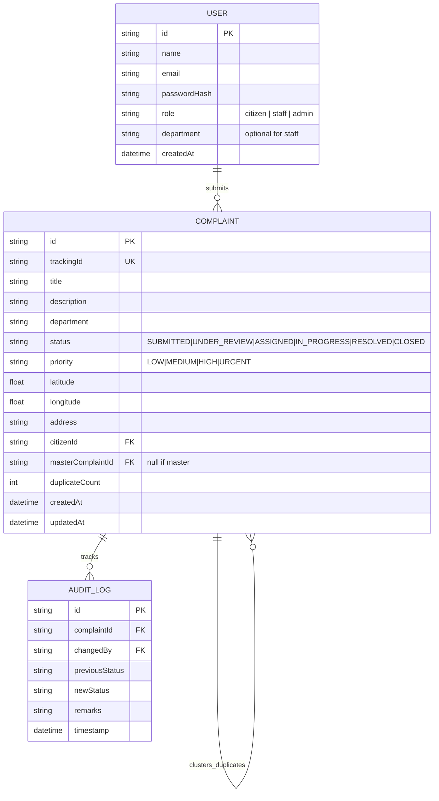

# CivicLens: Municipal Complaint Portal with Geotagging
## Phase 1: Introduction to AI in Software Engineering & System Requirements Specification (SRS)

**Course Module:** Phase 1 – Foundations of AI in Software Engineering  
**Project Identifier:** Question 50 (P50)  
**Author/Candidate:** Academic Project Submission  
**Version:** 1.0.0  
**Date:** November 2026  

---

## 1. Problem Definition & Context

Municipal corporations and city councils face severe operational bottlenecks in citizen grievance handling:
1. **Redundant & Duplicate Submissions:** When an urban disruption occurs (e.g., a burst water main or an open pothole on an arterial road), dozens of citizens independently file reports with varied phrasing, overwhelming triage desks.
2. **Ambiguous or Inaccurate Spatial Locality:** Text-only addresses ("near the temple behind the petrol pump") lead municipal response crews to waste hours locating issues or visiting incorrect spots.
3. **Misrouting & Departmental Latency:** Complaints frequently land in incorrect municipal departments (e.g., a flooded street caused by clogged drains routed to Roads rather than Sanitation & Stormwater), delaying SLA resolution.
4. **Lack of Transparency & Citizen Distrust:** Citizens lack real-time visibility into whether neighboring residents have already reported the issue and what stage of remediation the complaint is in.

**CivicLens (P50)** solves this by augmenting full-stack web software engineering with applied AI: combining exact coordinate capture (Geotagging via Leaflet/GPS), dual-threshold spatial-textual duplicate clustering, automated multi-class department routing, and an interactive GIS dashboard.

---

## 2. Traditional Software Engineering vs. AI-Augmented Software Engineering

| Evaluation Dimension | Traditional Software Engineering Approach | AI-Augmented Engineering (CivicLens) |
|---|---|---|
| **Duplicate Identification** | Exact string matching or identical database primary key lookups. Fails completely when citizens write slightly different descriptions ("burst pipe on 4th cross" vs "water leakage near bakery"). | **Hybrid Spatial-Textual AI:** Combines geospatial Haversine distance thresholding ($\le 75\text{m}$) with TF-IDF vectorization and Cosine Similarity ($\ge 0.65$), clustering conceptually identical grievances regardless of wording. |
| **Department Routing** | Hard-coded dropdown lists selected by citizens, who frequently choose the wrong category or select "Other/General". | **Supervised NLP Classification:** Analyzes grievance text and predicts the responsible department with confidence scoring, reducing manual triage overhead. |
| **Geographic Aggregation** | Static list views or tabular database exports requiring manual GIS coordinate cross-referencing. | **Interactive Map Clustering:** Dynamic bounding-box spatial clustering rendering density heat zones and marker clusters on Leaflet maps. |
| **Maintenance & Adaptability**| Keyword blacklist/whitelist rules requiring manual developer updates whenever civic terminology changes. | **Retrainable Statistical Feature Extraction:** Vocabulary n-grams and weight matrices that dynamically update with municipal operational logs. |
| **Development Lifecycle** | Manual test case authoring, manual documentation, static estimation heuristics. | **AI-Assisted SE Practices:** AI-assisted prompt engineering, synthetic test data generation, edge-case synthesis, and algorithmic bias auditing. |

---

## 3. Algorithmic & AI Feasibility Analysis

### 3.1 Spatial-Textual Duplicate Clustering Engine
To cluster duplicate complaints efficiently without $O(N^2)$ heavy deep neural network runtime overhead, CivicLens employs a two-stage filter:
1. **Spatial Pruning (Stage 1):** Calculate great-circle geodesic distance using the Haversine formula:
   $$d = 2R \arcsin\left(\sqrt{\sin^2\left(\frac{\Delta \phi}{2}\right) + \cos(\phi_1)\cos(\phi_2)\sin^2\left(\frac{\Delta \lambda}{2}\right)}\right)$$
   Where $R \approx 6,371,000\text{ meters}$, $\phi$ is latitude in radians, and $\lambda$ is longitude in radians. If $d > D_{\text{threshold}}$ (default: $75\text{ meters}$), complaints are immediately pruned from duplicate candidacy.
2. **Textual Similarity (Stage 2):** For complaints within $D_{\text{threshold}}$, convert cleaned tokenized descriptions into Term Frequency-Inverse Document Frequency (TF-IDF) vectors and compute Cosine Similarity:
   $$\text{Cosine Similarity}(\vec{u}, \vec{v}) = \frac{\vec{u} \cdot \vec{v}}{\|\vec{u}\| \|\vec{v}\|}$$
   If $\text{Similarity} \ge 0.65$, the incoming complaint is linked as a child duplicate of the master complaint ticket, incrementing its urgency weight.

### 3.2 Department Routing Classifier
Municipal complaints are categorized into six core departments:
- `ROADS`: Potholes, damaged asphalt, missing manhole covers, speed bumps.
- `WATER_SUPPLY`: Pipe leaks, contaminated tap water, low water pressure, broken mains.
- `SANITATION`: Uncollected garbage, open dumping, overflowing dumpsters, carcass removal.
- `ELECTRICITY`: Broken streetlights, hanging wires, transformer sparks, dark alleys.
- `HEALTH_SAFETY`: Stray animal menace, mosquito breeding, open chemical effluent.
- `PARKS`: Fallen branches, broken playground equipment, unkempt lawns.

Using TF-IDF unigram and bigram extraction paired with Multinomial Naive Bayes probability estimates, incoming grievances are scored and routed automatically with an explainable confidence metric.

---

## 4. Software Requirements Specification (SRS) - IEEE 830 Standard

### 4.1 Functional Requirements (FR)
- **FR-1 [User Authentication & Roles]:** The system shall authenticate citizens, municipal staff, and administrators using JWT tokens and bcrypt password hashing (minimum 10 salt rounds).
- **FR-2 [Geotagged Complaint Submission]:** The system shall allow citizens to file complaints by providing title, description, category, and attaching geographic coordinates via device geolocation or Leaflet pin-drop.
- **FR-3 [Reverse Geocoding / Address Resolution]:** The system shall resolve latitude and longitude coordinates into a human-readable neighborhood/locality address.
- **FR-4 [Interactive GIS Mapping]:** The system shall display complaints on an interactive Leaflet map with color-coded markers (Red: Open/Pending, Amber: In Progress, Green: Resolved).
- **FR-5 [Duplicate Complaint Clustering]:** The system shall automatically evaluate incoming complaints against existing open complaints in the database and cluster those meeting distance ($\le 75\text{m}$) and text similarity ($\ge 0.65$) thresholds.
- **FR-6 [Department Routing & Triage]:** The system shall suggest or auto-assign the appropriate municipal department based on NLP classification with visible confidence scores.
- **FR-7 [Complaint Lifecycle Management]:** The system shall enforce a strict state machine: `SUBMITTED` $\rightarrow$ `UNDER_REVIEW` $\rightarrow$ `ASSIGNED` $\rightarrow$ `IN_PROGRESS` $\rightarrow$ `RESOLVED` $\rightarrow$ `CLOSED`.
- **FR-8 [Staff & Admin Dashboard]:** Municipal staff shall have access to a dashboard to filter complaints by department, review duplicate clusters, reassign departments, and update resolution notes.
- **FR-9 [Analytics & SLA Monitoring]:** The system shall provide analytical metrics including average resolution time, department workload distribution, high-density problem heatmaps, and SLA breach warnings.

### 4.2 Non-Functional Requirements (NFR)
- **NFR-1 [Performance]:** Spatial distance and similarity calculations for incoming complaints must execute within $< 300\text{ ms}$ on a municipal database of up to 10,000 active complaints.
- **NFR-2 [Security]:** Passwords must never be stored in plaintext. JWT tokens must expire after 24 hours. API inputs must be sanitized against NoSQL injection and XSS.
- **NFR-3 [Privacy]:** Exact residential coordinates must be protected. Public views shall display jittered/neighborhood-level points while municipal staff access precise coordinates.
- **NFR-4 [Reliability & Resilience]:** The backend must provide a self-contained in-memory database fallback to ensure zero downtime and instant evaluation readiness even when external database clusters are offline.
- **NFR-5 [Portability]:** The solution must be containerized with Docker and deployable across any Linux/Windows/macOS environment.
- **NFR-6 [Accessibility & Responsiveness]:** The frontend interface must be fully responsive across mobile smartphones, tablets, and desktop workstations.

---

## 5. System Architecture & Entity Relationships

