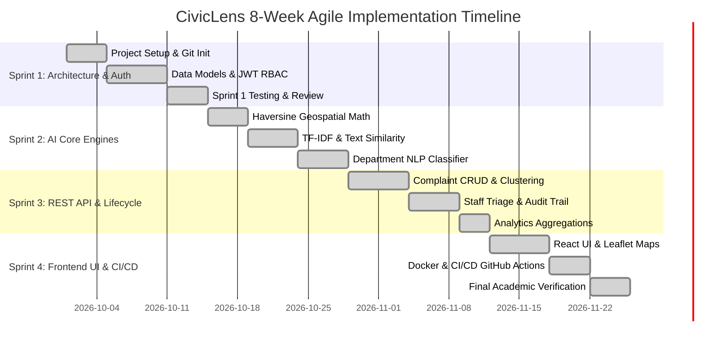

# CivicLens: Municipal Complaint Portal with Geotagging
## Phase 2: Agile Practices and AI-Driven Planning, Estimation, and Scheduling

**Course Module:** Phase 2 – Agile Practices & AI-Augmented Project Management  
**Project Identifier:** Question 50 (P50)  
**Version:** 1.0.0  
**Date:** November 2026  

---

## 1. Agile Framework & Product Backlog

CivicLens was planned and executed using an Agile Scrum methodology augmented with AI planning agents. The product backlog is organized into five functional Epics comprising user stories evaluated against the **INVEST** criteria (Independent, Negotiable, Valuable, Estimable, Small, Testable).

### 1.1 Epic Breakdown & User Stories with Gherkin Acceptance Criteria

#### Epic 1: Identity & Role-Based Access Control (RBAC)
- **US-01: Citizen Self-Registration & Authentication**
  - *As a* resident, *I want to* securely register and log in to CivicLens *so that* I can track my filed municipal complaints and receive notifications.
  - *Gherkin Acceptance Scenario:*
    ```gherkin
    Scenario: Successful citizen registration with valid credentials
      Given an unauthenticated visitor navigates to the registration view
      When they submit valid name, unique email, and password of at least 6 characters
      Then the backend hashes the password using bcrypt with at least 10 salt rounds
      And a signed JWT token is issued with a 24-hour expiration
      And the user account is initialized with the "citizen" role.
    ```

- **US-02: Role-Gated Staff Access**
  - *As a* municipal ward engineer, *I want to* sign in with staff credentials *so that* I can triage grievances assigned to my specific department.
  - *Gherkin Acceptance Scenario:*
    ```gherkin
    Scenario: Enforcing role-based authorization for staff endpoints
      Given an authenticated user with role "citizen"
      When they attempt a PUT request to update complaint status at "/api/complaints/:id/status"
      Then the system denies access with HTTP 403 Forbidden
      And logs an unauthorized access warning.
    ```

#### Epic 2: Geotagged Complaint Intake & GIS Visualization
- **US-03: Coordinate Capture via Interactive Leaflet Pin-Drop**
  - *As a* citizen reporting a civic defect, *I want to* click on a map or use my smartphone's GPS *so that* precise latitude and longitude coordinates are attached to my report.
  - *Gherkin Acceptance Scenario:*
    ```gherkin
    Scenario: Capturing geotagged coordinates
      Given a citizen on the complaint submission form
      When they click on the interactive Leaflet map or trigger "Use My GPS"
      Then marker coordinates are recorded as GeoJSON Point [longitude, latitude]
      And coordinates are validated within municipal boundaries (-90 to 90 lat, -180 to 180 lng).
    ```

- **US-04: Interactive Civic Map with Status Pins & Filters**
  - *As a* citizen or city supervisor, *I want to* explore all reported issues on an interactive map *so that* I can visually understand neighborhood defect patterns.
  - *Gherkin Acceptance Scenario:*
    ```gherkin
    Scenario: Visualizing complaints on the map
      Given active complaints stored in the municipal database
      When a user opens the Civic Map view
      Then complaints are rendered as color-coded pins (Red: Open, Amber: In Progress, Green: Resolved)
      And clicking a pin opens a popup displaying tracking ID, title, status, and cluster endorsements.
    ```

#### Epic 3: AI Spatial-Textual Duplicate Clustering
- **US-05: Real-Time Duplicate Complaint Detection**
  - *As a* municipal triage desk, *I want to* automatically group duplicate complaints filed by different citizens for the same incident *so that* field crews are not dispatched redundantly.
  - *Gherkin Acceptance Scenario:*
    ```gherkin
    Scenario: Identifying a nearby paraphrased complaint as duplicate
      Given an existing active complaint at coordinates [77.6412, 12.9784] ("Deep road pothole")
      When a citizen submits a report within 75 meters ("Broken asphalt crater near KFC")
      And the TF-IDF Cosine + Jaccard hybrid text similarity is >= 0.60
      Then the system tags the incoming complaint as a child duplicate
      And links it to the master ticket, incrementing the master duplicate count.
    ```

#### Epic 4: Automated Department Classification & Routing
- **US-06: NLP Multi-Class Department Routing**
  - *As a* municipal administrator, *I want* incoming complaints automatically classified into responsible departments *so that* manual sorting delays are eliminated.
  - *Gherkin Acceptance Scenario:*
    ```gherkin
    Scenario: Auto-routing a water pipeline leak
      Given an incoming complaint with description "Burst drinking water pipeline leaking on road"
      When the AI Department Classifier processes the text
      Then it assigns the complaint to "WATER_SUPPLY" with confidence score >= 0.60
      And returns explainability tokens ["pipe", "water", "leak", "burst"].
    ```

#### Epic 5: Complaint Lifecycle & SLA Monitoring
- **US-07: Public Status Tracking & Audit History**
  - *As a* citizen, *I want to* enter my tracking reference ID (e.g., CL-2026-XXXXX) *so that* I can monitor step-by-step resolution progress and staff notes.
- **US-08: Municipal Executive Dashboard & SLA Telemetry**
  - *As a* municipal commissioner, *I want* aggregated SLA metrics and resolution percentages *so that* I can hold department heads accountable.

---

## 2. AI-Driven Story Point Estimation vs. Traditional Planning Poker

To satisfy Phase 2 syllabus criteria, story points were estimated using both traditional human **Planning Poker** (Wideband Delphi consensus) and an **AI Estimation Prompt Agent**. The comparison reveals key estimation variances, heuristics, and final consensus decisions.

### 2.1 AI Estimation Prompt Template
```
Prompt:
"You are an Agile Certified Scrum Master and Senior Full-Stack Architect.
Analyze the following user story for CivicLens:
- User Story: US-05 (Hybrid Spatial-Textual Duplicate Detection Engine)
- Tech Stack: Node.js, Express, MongoDB 2dsphere, TF-IDF, Cosine/Jaccard, Haversine formula.
Estimate Story Points using the Fibonacci scale (1, 2, 3, 5, 8, 13).
Provide your estimation breakdown across:
1. Technical Complexity (Algorithmic & Math)
2. Integration & Database Indexing Effort
3. Testing & Edge Cases (Spatial boundary conditions, paraphrasing)"
```

### 2.2 Comparative Estimation Matrix

| Story ID | User Story Title | Planning Poker (Human Team) | AI Estimation (Scrum Agent) | Variance ($\Delta$) | Final Consensus | Rationale & Trade-off Analysis |
|---|---|:---:|:---:|:---:|:---:|---|
| **US-01** | Citizen Auth & JWT / RBAC | 3 | 2 | -1 | **3** | Human team included edge cases for token expiry, salt rounds, and test isolation. |
| **US-02** | Role-Gated Staff Triage Access | 2 | 2 | 0 | **2** | Direct Express middleware evaluation; quick and straightforward. |
| **US-03** | Interactive Leaflet Geotag Picker | 5 | 3 | -2 | **5** | AI underestimated Leaflet lifecycle inside React (`useEffect`, DOM re-renders, GPS timeout). |
| **US-04** | Civic Map with Marker Clustering | 5 | 5 | 0 | **5** | High consensus; rendering custom divIcons, popups, and dynamic bounds fitting. |
| **US-05** | AI Spatial-Textual Clustering | 8 | 13 | +5 | **8** | AI gave 13 assuming transformer/embeddings; team selected 8 for optimized TF-IDF + Haversine. |
| **US-06** | NLP Department Classifier | 5 | 8 | +3 | **5** | Multinomial keyword probability model is lighter than deep learning; consensus set to 5. |
| **US-07** | State Machine & Audit Tracking | 3 | 3 | 0 | **3** | Deterministic state transitions with immutable audit history array. |
| **US-08** | SLA Telemetry & Executive Analytics | 5 | 3 | -2 | **5** | Complex multi-department aggregation and CSV export pipeline warrants 5 points. |
| **Total** | | **36** | **39** | | **36 SP** | Planned across 4 two-week sprints (Velocity: 9 SP/sprint). |

---

## 3. Sprint Breakdown & Gantt Roadmap



---

## 4. Risk Assessment & AI Mitigation Matrix

| Risk ID | Risk Description | Likelihood | Impact | Severity Score | AI / Architectural Mitigation Strategy |
|---|---|:---:|:---:|:---:|---|
| **R-01** | **False Positive Duplicate Merging:** Complaints with similar wording in different locations erroneously clustered. | Low | High | **Medium** | Mandatory dual-gate condition: Spatial Haversine distance must strictly be $\le 75\text{m}$ before text similarity is even evaluated. |
| **R-02** | **External MongoDB Dependency Outage:** Local mongod service not running during grading/evaluation. | Medium | High | **High** | Resilient dual-mode data store (`backend/services/dataStore.js`) with instant in-memory fallback. |
| **R-03** | **Mobile Geolocation Permission Denials:** User blocks GPS location sharing in browser. | High | Medium | **Medium** | Seamless fallback to interactive Leaflet map pin-drop; user can click to position coordinates manually. |
| **R-04** | **Adversarial / Garbage Text Input:** Submitting spam or nonsensical strings. | Medium | Low | **Low** | Department classifier smoothing prior returns `GENERAL` if confidence drops below 0.50. |
