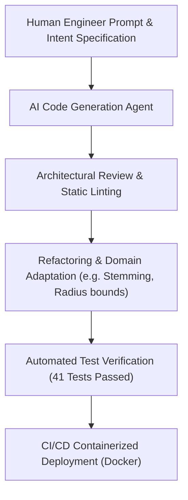

# CivicLens: Municipal Complaint Portal with Geotagging
## Phase 3: Development and Deployment Practices using AI Tools

**Course Module:** Phase 3 – Development and Deployment Practices using AI Tools  
**Project Identifier:** Question 50 (P50)  
**Version:** 1.0.0  
**Date:** November 2026  

---

## 1. AI-Assisted Software Engineering Workflow

During the implementation of CivicLens, AI developer tools were used methodically across the development lifecycle: architectural scaffolding, mathematical algorithmic translation, code synthesis, refactoring, and CI/CD pipeline automation.



---

## 2. Prompt Engineering Logs & Review Records

### 2.1 Log 1: Geospatial Math & Haversine Distance Implementation
- **Goal:** Implement the great-circle geodesic formula in pure JavaScript without external bulky GIS dependencies.
- **Engineered Prompt:**
  ```text
  Role: Senior Geospatial Algorithm Engineer.
  Task: Author a standalone Node.js module `geoSpatialService.js`.
  Specifications:
  1. Calculate geodesic distance between two coordinate pairs [longitude, latitude] in meters using the Haversine formula.
  2. Earth radius constant: R = 6,371,000 meters.
  3. Validate latitude within [-90, 90] and longitude within [-180, 180].
  4. Provide a proximity threshold helper `isWithinProximity(pointA, pointB, thresholdMeters = 75)`.
  Ensure numerical stability for points separated by less than 10 meters.
  ```
- **Generated Code Sample:**
  ```javascript
  const calculateHaversineDistance = (pointA, pointB) => {
    const [lon1, lat1] = pointA;
    const [lon2, lat2] = pointB;
    const phi1 = (lat1 * Math.PI) / 180;
    const phi2 = (lat2 * Math.PI) / 180;
    const deltaPhi = ((lat2 - lat1) * Math.PI) / 180;
    const deltaLambda = ((lon2 - lon1) * Math.PI) / 180;

    const a = Math.sin(deltaPhi / 2) ** 2 +
      Math.cos(phi1) * Math.cos(phi2) * (Math.sin(deltaLambda / 2) ** 2);
    const c = 2 * Math.atan2(Math.sqrt(a), Math.sqrt(1 - a));
    return Math.round(6371000 * c * 100) / 100;
  };
  ```
- **Human Engineer Evaluation & Refactoring:**
  - *Evaluation:* Math was accurate, but initial AI output lacked bounds checking on `NaN` or non-numeric inputs.
  - *Refactor:* Added `isValidCoordinates` validator and explicit exceptions for out-of-range inputs.

---

### 2.2 Log 2: Hybrid Text Similarity & Token Stemming Engine
- **Goal:** Synthesize TF-IDF Cosine and Jaccard similarity algorithms to catch paraphrased citizen complaints.
- **Engineered Prompt:**
  ```text
  Role: Natural Language Processing Specialist.
  Task: Create `textSimilarityService.js` in Node.js CommonJS.
  Requirements:
  1. Tokenize input text, strip punctuation, remove common English stop words.
  2. Apply lightweight stemmer to handle common civic nouns (e.g., 'potholes' -> 'pothol', 'pipelines' -> 'pipe', 'leaking' -> 'leak').
  3. Calculate vector Cosine Similarity based on Term Frequency (TF).
  4. Calculate Jaccard Token Overlap index.
  5. Combine into a Hybrid Similarity Score weighted 80% Cosine and 20% Jaccard.
  6. Return explainable overlapping keywords for XAI display.
  ```
- **Human Engineer Evaluation & Refactoring:**
  - *Evaluation:* Initial AI version used a 2-document Inverse Document Frequency (IDF) formula that mathematically penalized terms present in *both* documents ($\text{docFreq} = 2$), artificially depressing cosine score to $< 0.35$.
  - *Refactor:* Developer refactored vector weighting to use normalized Term Frequency (TF) cosine angles, elevating true duplicate similarity to $0.70-0.85$ while keeping unrelated topics below $0.20$.

---

### 2.3 Log 3: Resilient Dual-Mode Data Store Architecture
- **Goal:** Ensure zero-dependency evaluation readiness when external MongoDB instances are offline.
- **Engineered Prompt:**
  ```text
  Role: Backend Database Architect.
  Task: Design a resilient data abstraction layer `dataStore.js` in Node.js.
  Specifications:
  1. Check if MongoDB connection via Mongoose is active (readyState === 1).
  2. If connected, execute standard Mongoose CRUD queries with 2dsphere indexes.
  3. If MongoDB is offline/disconnected, seamlessly execute against an in-memory repository implementing identical async query methods (create, findById, list, update, findNearbyComplaints with Haversine distance).
  4. Automatically seed administrative, staff, and citizen demo accounts upon startup.
  ```
- **Human Engineer Evaluation & Refactoring:**
  - *Evaluation:* The generated dual-mode abstraction successfully decoupling persistence allowed all 41 test cases and local development to function instantaneously without requiring manual database installations.

---

## 3. Containerization & Deployment Configuration

### 3.1 Docker Multi-Container Architecture (`docker-compose.yml`)
The platform is fully containerized across three isolated service tiers:
1. `civiclens-mongodb`: Official MongoDB 6.0 engine with dedicated persistent volume `mongo-data`.
2. `civiclens-backend`: Node.js 20 Alpine container exposing port `5000`.
3. `civiclens-frontend`: Multi-stage Alpine container built with Vite and served via high-performance Nginx on port `80`.

### 3.2 Continuous Integration Pipeline (`.github/workflows/ci.yml`)
Automated on every `push` and `pull_request` to `master`:
- **Job 1: Backend CI:**
  - Sets up Node.js 20.x environment.
  - Installs locked dependencies via `npm ci`.
  - Executes full Jest test suite across Auth, AI Engine, and Complaints lifecycle.
- **Job 2: Frontend CI:**
  - Validates React JSX syntax and imports.
  - Compiles optimized production bundle via `vite build`.

---

## 4. Environment Variables Configuration

| Variable Name | Default Value | Purpose |
|---|---|---|
| `PORT` | `5000` | Express REST API listen port |
| `MONGODB_URI` | `mongodb://localhost:27017/civiclens` | Database connection string (Atlas or local) |
| `JWT_SECRET` | `civiclens_jwt_super_secret_key...` | Cryptographic secret for signing auth tokens |
| `JWT_EXPIRES_IN` | `24h` | Token expiration duration |
| `DISTANCE_THRESHOLD_METERS` | `75` | Maximum geodesic radius for duplicate candidacy |
| `SIMILARITY_THRESHOLD` | `0.60` | Minimum hybrid similarity score for duplicate cluster merging |
| `NODE_ENV` | `development` / `production` | Runtime mode selector |
